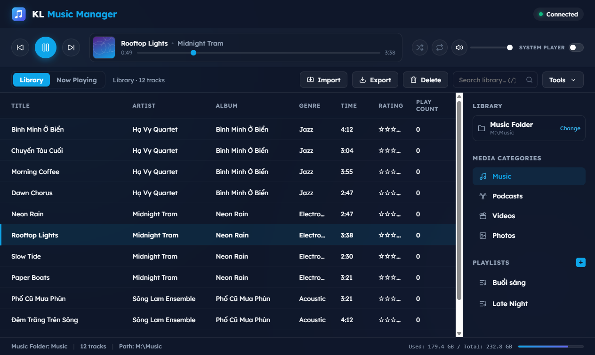
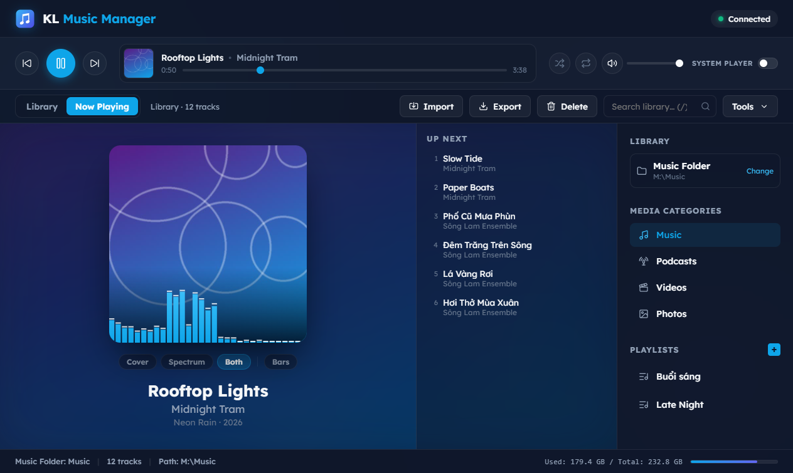
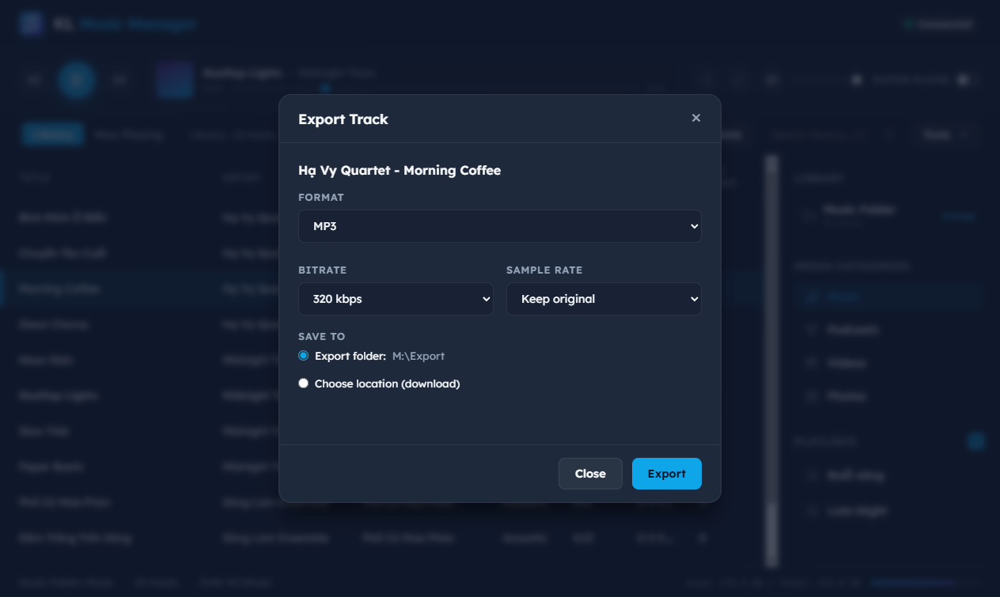

# KL Music Manager

**KL Music Manager** is a desktop music player and library manager for **classic iPods** (Classic, Nano, Mini, Shuffle, Video) and for **music folders on your computer**: a full music player, iPod import/export with conversion, and a fast, accent-insensitive library search, in a modern 64-bit app.

Everything runs locally: no account, no Internet connection, no telemetry.



| Now Playing (cover + spectrum) | Export with conversion |
|---|---|
|  |  |

---

## Features

- **Music player**: queue (Up Next, Play Next / Add to Queue), shuffle, repeat all / one, volume, auto-advance, keyboard shortcuts, OS media keys and the Windows media overlay.
- **Now Playing view**: large album art on a blurred backdrop, a real-time **spectrum analyzer** (bars or wave), or both.
- **Libraries**: an iPod (USB disk mode), an always-available **Default library** (a virtual iPod on the computer), or any number of **music folders**, each a named library (sub-folders scanned, `.m3u/.m3u8` playlists). Tags and file details are indexed in a local SQLite database; rescan, rebuild or clear each library from *Tools → Manage Libraries…*, optionally rescan automatically when the computer is idle.
- **Browse** tab: a tag cloud of genres, artists, albums, years and playlists; click to filter.
- **Manage** tab: select many tracks, whole albums, artists or playlists, and export them in one go with one format for the whole list (Artist / Album folders, skip existing files, progress and Cancel; parallel for music folders). Remove libraries from the app without touching the music.
- **File details** of the playing track: codec, bitrate, sample rate, bit depth, channels, size.
- **Tag editor** for music folders: title, artists, album, genre, composer, year, track / disc numbers, BPM, comment, lyrics and **album art** (per track or whole album).
- **Library search** across title, artist, album, album artist, genre and composer — ignores Vietnamese accents (`hong nhung` finds *Hồng Nhung*).
- **Import** many files or whole folders at once, straight into a playlist, with per-file progress.
- **Export with conversion** to MP3, AAC, FLAC, ALAC or WAV (bitrate, sample rate, FLAC level), keeping tags and cover art. Uses the bundled ffmpeg.
- **Apple Lossless and DTS-in-WAV playback** by converting to FLAC on the fly (cached).
- **Library reports**: track list and library information as HTML or JSON.
- **Safe read-only mode** that blocks every write to the device, enforced by the backend.
- **iPod database round-trip** with the checksums newer iPods need (`hash58` / `hash72`).
- **Built-in user guide** (Vietnamese and English): *Tools → User Guide* or F1.

## System requirements

| | Minimum |
|---|---|
| Desktop app (installer) | **Windows 10 or 11, 64-bit (x64)** |
| Disk space | about 450 MB installed (installer 151 MB) |
| iPod | USB mass-storage iPods, **Windows-formatted (FAT32)**; Mac-formatted (HFS+) iPods cannot be read on Windows |
| macOS (build from source) | macOS 13 Ventura or newer (Electron 45 requirement) — not yet released or tested |
| Browser mode (from source) | Python 3.10+ on Windows, macOS or Linux, any modern browser |

Sources: Electron 45 supports Windows 10+ (x64/arm64) and macOS 13+; the bundled Python 3.12 runtime supports Windows 8.1+, so Electron sets the floor. The installer is built for x64 only.

## Install

Download `KL-Music-Manager-Setup-<version>.exe`, run it and start **KL Music Manager** from the Start menu. The installer is not code-signed yet, so Windows SmartScreen may ask for confirmation (*More info → Run anyway*).

## Documentation

- User guide — Tiếng Việt: [static/help/guide.vi.md](static/help/guide.vi.md)
- User guide — English: [static/help/guide.en.md](static/help/guide.en.md)
- The same guide is built into the app: *Tools → User Guide* (F1), or the *Help* menu.
- Changes per release: [CHANGELOG.md](CHANGELOG.md)

## Build from source

Requirements: Python 3.10+ (3.12 used for releases), Node.js 24 with npm, and ffmpeg for conversion features.

```bash
python -m venv .venv
.venv\Scripts\activate          # macOS/Linux: source .venv/bin/activate
python -m pip install -r requirements-dev.txt
npm install                     # if Electron reports it is not installed: node node_modules/electron/install.js
```

Run:

```bash
npm start                       # desktop window (Electron + backend from .venv)
python app.py                   # browser mode at http://127.0.0.1:5055
```

`KL-Music-Manager.bat` (Windows) and `KL-Music-Manager.command` (macOS) start browser mode.

Check (lint, format, Python and JS tests):

```bash
python scripts/check.py
```

### Build the Windows installer

```bash
npm install                        # once (see "Build from source")
python packaging/fetch_ffmpeg.py   # once: downloads the ffmpeg "essentials" build from gyan.dev and verifies its SHA-256
npm run dist
```

A *shared* ffmpeg build (with `avcodec-*.dll` next to `ffmpeg.exe`) is refused because only `ffmpeg.exe` is bundled.

This freezes the backend with PyInstaller (`packaging/kl-music-manager-backend.spec` → `KL-Music-Manager-Backend.exe`), bundles ffmpeg, and runs electron-builder. Output in `dist/`: `KL-Music-Manager-Setup-<version>.exe` and `win-unpacked/KL-Music-Manager.exe`.

## Configuration

Settings are edited in the app (*Tools → Settings…*) and stored in `config.json`:

- Installed app: `%APPDATA%\KL Music Manager\config.json`
- From source: `config.json` in the project folder (override with the `KLMM_DATA_DIR` environment variable)

See the *Settings* and *Where data is stored* sections of the user guide for every option.

## Project layout

| Path | Purpose |
|---|---|
| `app.py` | Flask backend (REST API + static files) |
| `ipod_manager.py` | Library logic: iPod or music folder, import/export, streaming |
| `pygpod/` | Pure-Python iPod database library (iTunesDB, artwork, checksums) |
| `folder_library.py`, `library_db.py`, `tag_editor.py` | Music folders, the SQLite library database, tag / cover reading and writing |
| `artwork.py`, `converter.py`, `library_export.py`, `settings.py` | Cover art, ffmpeg conversion, reports, configuration |
| `static/` | Web UI (`app.js`, `js/` modules, `help/` user guide, `icons/` Lucide sprite + app logo, `fonts/` Lexend) |
| `electron/` | Desktop shell (starts the backend, window, menus) |
| `packaging/` | PyInstaller spec, ffmpeg fetcher, build script, logo (`make_logo.py`) and icon sprite (`make_icon_sprite.py`) generators |
| `tests/` | pytest suite and `tests/js` (node:test) |

## Personalizing your build

This repository is published by [xfree123](https://github.com/xfree123) (app ID `io.github.xfree123.klmusicmanager`). If you fork it and publish your own build, change the author, app ID, homepage and copyright: see [PERSONALIZE.md](PERSONALIZE.md) for every place.

## License

Copyright © 2026 xfree123 and KL Music Manager contributors.

KL Music Manager is free software: you can redistribute it and/or modify it under the terms of the **GNU General Public License as published by the Free Software Foundation, either version 3 of the License, or (at your option) any later version**. It is distributed in the hope that it will be useful, but WITHOUT ANY WARRANTY. See [LICENSE](LICENSE) for the full text and [THIRD_PARTY_NOTICES.md](THIRD_PARTY_NOTICES.md) for bundled components (Electron, ffmpeg, Python libraries, Lucide icons, the Lexend font).

## Credits

- Based on **Floola-Next** (<https://github.com/k-s-b/floola-next>, GPL-3.0-or-later), itself a modern take on the discontinued 32-bit Floola. See [THIRD_PARTY_NOTICES.md](THIRD_PARTY_NOTICES.md).
- Icons: [Lucide](https://lucide.dev) (ISC). Font: [Lexend](https://www.lexend.com) (SIL OFL 1.1).
